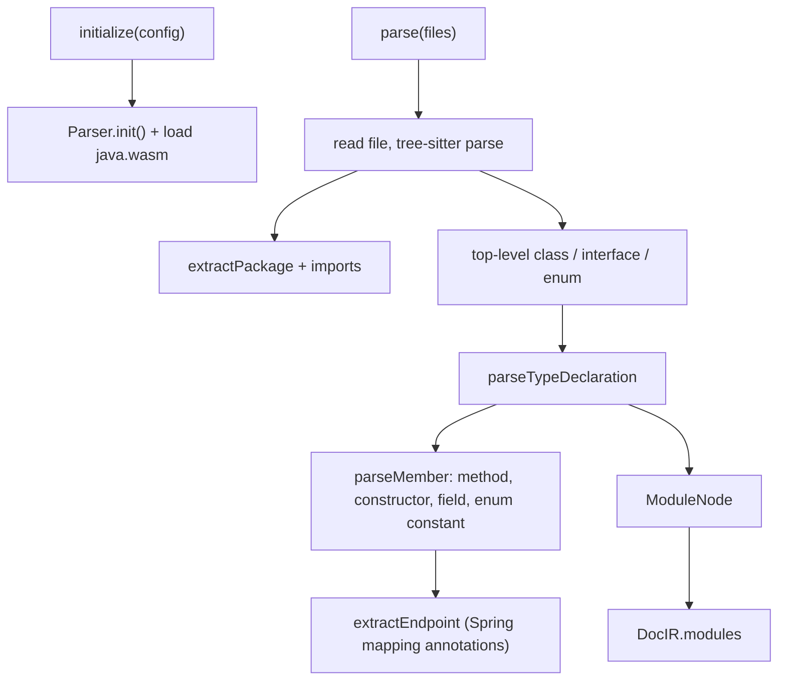

# @docgen/parser-java -- Technical Reference

<!-- conduit-change: CONDUIT-2026-001 -->

> **Evidence.** Written from `packages/parser-java/src/index.ts` and its test at RepoScribe commit `4cbc9e4` (2026-08-11). Statements marked *(by code reading)* are not covered by a test. The test suite was not re-run when this document was written.

## 1. Overview

`@docgen/parser-java` is the Java and Spring Boot parser plugin. It reads `.java` source files, builds a DocIR (Document Intermediate Representation) `ModuleNode` for every top-level class, interface and enum, and extracts Javadoc, annotations and Spring MVC endpoint metadata. It uses the Java grammar from `tree-sitter-wasms`, loaded through `web-tree-sitter`, so no JDK is needed to parse.

**Where it fits:** the parse layer of the pipeline.

```
Java source --> [@docgen/parser-java] --> DocIR --> [Transformers] --> DocIR --> [Renderers] --> Output Files
                ^^^^^^^^^^^^^^^^^^^^^
```

- **npm package:** `@docgen/parser-java` v1.1.0
- **Dependencies:** `@docgen/core` (workspace), `tree-sitter-wasms` ^0.1.13, `web-tree-sitter` 0.20.8
- **Source file:** `packages/parser-java/src/index.ts` (494 lines, single file)
- **Export:** `JavaParser` class (named and default export)
- **Plugin type:** `parser`; `language = "java"`; `supports = ["java"]`

---

## 2. Installation & Setup

The package is part of the RepoScribe monorepo. Add a `java` entry under `languages` in `.docgen.yaml`:

```yaml
languages:
  - name: java
    source: src/main/java
    include: ["**/*.java"]
    exclude: ["**/test/**", "**/generated/**"]
    parser: "@docgen/parser-java"
```

The orchestrator loads every parser named in `languages[].parser`. The end-to-end fixture `fixtures/e2e/.docgen.yaml` combines a TypeScript and a Java source tree in one run.

Programmatic use (this mirrors the package test):

```typescript
import { JavaParser } from "@docgen/parser-java";

const parser = new JavaParser();
await parser.initialize({
  projectConfig: resolvedConfig,
  workDir: "/path/to/repo",
  options: {},
  logger: console,
});

const docir = await parser.parse(["/path/to/repo/src/main/java/com/example/UserController.java"], {});
```

**Requirements:** Node.js 20 or later. `initialize` resolves `tree-sitter-wasms/out/tree-sitter-java.wasm` with `require.resolve`, so the dependency must be installed.

---

## 3. Architecture

### Single-file design

The whole parser is one class, `JavaParser`, with the standard plugin lifecycle (`initialize`, `validate`, `parse`, `cleanup`) and a set of private helpers. There is no template engine or code generation.

### Parse flow



`parse` calls `initialize` itself if the parser was not initialised. The language configuration argument (`_langConfig`) is not used; file selection is done by the orchestrator before `parse` is called.

### Scope of what is parsed

Only these node types directly under the compilation unit become modules: `class_declaration`, `interface_declaration`, `enum_declaration`. Inside a type body only `method_declaration`, `constructor_declaration`, `field_declaration` and `enum_constant` become members.

---

## 4. Public API Reference

### JavaParser class

```typescript
export class JavaParser implements ParserPlugin {
  readonly name = "@docgen/parser-java";
  readonly version = "1.1.0";
  readonly type = "parser";
  readonly language = "java";
  readonly supports = ["java"];

  async initialize(config: PluginConfig): Promise<void>;
  async validate(): Promise<PluginValidationResult>; // always { valid: true, errors: [], warnings: [] }
  async parse(files: string[], _langConfig: unknown): Promise<DocIR>;
  async cleanup(): Promise<void>; // no-op
}
```

`parse` returns a DocIR whose `modules` hold the result. Its metadata is a placeholder (`name: "unnamed"`, `version: "0.0.0"`). The orchestrator copies only `modules`, `adrs` and `changelog` from each parser result into its own DocIR, so the placeholder does not reach the output.

### Module mapping (`ModuleNode`)

| Field | Value |
|---|---|
| `id` | `<package>.<TypeName>`, or `<TypeName>` when there is no package |
| `name` | Type name (`"Anonymous"` if the grammar yields none) |
| `filePath` | Path relative to `workDir` |
| `kind` | `class`, `interface` or `enum` |
| `description`, `tags` | From the Javadoc block directly before the type |
| `members` | See member mapping below |
| `dependencies` | One `import` entry per import statement, plus an `inheritance` entry for the superclass |
| `decorators` | Class annotations (name and raw text) |
| `typeParameters` | Generic parameters with an optional `extends` constraint |
| `extends`, `implements` | Superclass text, and the `implements` list when present |
| `exports` | Always `{ isDefault: false, isNamed: true, exportedName: <name> }` |
| `sourceFacts.fileRole` | `route` for `@RestController` / `@Controller`; `service` for `@Service` / `@Repository`; otherwise `unknown` |
| `sourceFacts.usesServiceDependencies` | `true` for `@Service` / `@Repository` |

Recognised stereotype annotations: `RestController`, `Controller`, `Service`, `Repository`, `Component`. `@Component` is detected but maps to `fileRole: "unknown"`.

### Member mapping (`MemberNode`)

| Source construct | `kind` | Notes |
|---|---|---|
| Method | `method` | `isAbstract` is true when there is no body (interface methods) |
| Constructor | `constructor` | `returnType` is `null`; no endpoint extraction |
| Field | `field` | One member per declarator; `signature` is the declaration without the trailing `;` |
| Enum constant | `enum-member` | `returnType` is `null` |

Other member fields:

- `visibility`: `private`, `protected` or `public` from the modifiers; anything else (package-private, or an interface method with no modifier) is `internal`.
- `isStatic` and `isAbstract` come from the modifier text; `isAsync` is always `false`.
- `signature` for methods and constructors is the text up to the body.
- `parameters`: `name`, `type`, `description`, `isRest` (true for varargs); `isOptional` is always `false`. `description` is the text of the matching `@param` tag in the Javadoc of the method or constructor, or an empty string. A varargs parameter (`String... parts`) is reported under its own name with the array type of its element (`String[]`). A `@param` tag that names no real parameter is ignored there but stays in the member's `tags`. Covered by `src/index.test.ts`.
- `deprecated`: set only from a Javadoc `@deprecated` tag. The `@Deprecated` annotation does not set it.

### Javadoc handling

A comment is used only when it is a `/** ... */` block that is the immediately preceding named sibling of the declaration. Lines are split into description text and `@tag` lines:

| Javadoc | Result |
|---|---|
| Plain text lines | Joined with spaces into `description` |
| `@param name text` | Tag `{ tag: "param", name, description }` |
| `@return text` | Tag `{ tag: "returns", description }` |
| `@throws Type text` / `@exception Type text` | An entry in `throws` and a tag `{ tag: "throws", name: Type, description }` |
| `@since`, `@deprecated` | Generic tag; also fills `since` / `deprecated` |
| Any other tag | Generic tag `{ tag, description }` |

`//` and `/* */` comments are ignored.

---

## 5. Spring Boot Endpoint Extraction

For each method, the first annotation matching `Get|Post|Put|Delete|Patch|Request` + `Mapping` produces an `EndpointInfo`.

| Annotation | `httpMethod` |
|---|---|
| `@GetMapping`, `@PostMapping`, `@PutMapping`, `@DeleteMapping`, `@PatchMapping` | `GET`, `POST`, `PUT`, `DELETE`, `PATCH` |
| `@RequestMapping` | The `RequestMethod.X` found in the annotation text, otherwise `ANY` |

**Path.** The method path comes from a `path = "..."` or `value = "..."` attribute, or the first string literal in the annotation. A class-level mapping annotation is used as a prefix. The two are joined, repeated slashes are collapsed and a trailing slash is removed (`/api` + `users/{id}` becomes `/api/users/{id}`).

**Parameters.**

| Parameter annotation | Recorded as |
|---|---|
| `@PathVariable` | `pathVariables`, `required: true`; name from `name` / `value` / the literal, else the Java parameter name |
| `@RequestParam` | `queryParameters`; `required` is false when `required = false` is given or a `defaultValue` exists; `defaultValue` is captured |
| `@RequestBody` | `requestBody` (the parameter type) |

**Response type.** `ResponseEntity<T>` is unwrapped to `T`; other return types are used as written.

Example, taken from the package test (`UserController.getUser`):

```json
{
  "httpMethod": "GET",
  "path": "/api/users/{id}",
  "pathVariables": [{ "name": "id", "type": { "raw": "String" }, "required": true }],
  "queryParameters": [{ "name": "verbose", "type": { "raw": "boolean" }, "required": false, "defaultValue": "false" }],
  "requestBody": null,
  "responseType": { "raw": "UserDto" }
}
```

(Type objects are abbreviated; the real objects also carry `name`, `isArray`, `isNullable`, `isUnion` and `typeArguments`.)

---

## 6. Error Handling & Known Limitations

### Error behaviour

- `initialize` throws if the WASM grammar cannot be loaded.
- `parse` reads each file with `fs.readFileSync`; an unreadable file throws and aborts the whole call. There is no per-file recovery.
- tree-sitter is error tolerant, so a file with syntax errors still yields a partial tree. Only a `null` tree is skipped.
- `validate` always reports valid.

### Not supported *(by code reading)*

- `record` declarations and `@interface` annotation types are not modules.
- Nested and inner types are not modules, and their members are not visited from the outer type.
- Array-valued mapping paths such as `value = {"/a", "/b"}` are not parsed into separate routes.
- `DecoratorNode.arguments` is always `{}`; only the raw annotation text is kept.
- Interface `extends` lists are not recorded as `implements` (the parser reads the grammar's `interfaces` field only).
- `isNullable` and `isUnion` on type references are always `false`; arrays are recognised only by a trailing `[]`.
- *Fixed by AUDIT-001 (RS-05):* parameter descriptions used to be empty because the lookup read a comment before the parameter list instead of before the method, and a varargs parameter was reported as `arg` with type `Object`. Both are now tested.

---

## 7. Integration Guide

- **With renderers.** In exhaustive mode `@docgen/renderer-html` shows endpoint data on a member as a method badge, a path and the response type. See [renderer-html.md](renderer-html.md). `@docgen/renderer-pdf` does not render endpoint details separately; see [renderer-pdf.md](renderer-pdf.md).
- **CLI.** Run `reposcribe-cli generate` with a `java` language entry; `--format` selects the outputs (markdown, html, pdf) and `--mode` selects developer or exhaustive. See [cli.md](cli.md). This repository's own `.docgen.yaml` keeps the Java block commented out.
- **Mixed projects.** TypeScript and Java entries can be combined in one `.docgen.yaml`; `fixtures/e2e` does this and is exercised by `pnpm test:e2e`.

---

## 8. Internal Implementation Notes

- Private helpers: `parseTypeDeclaration`, `parseMember`, `memberBase`, `parseParameters`, `extractEndpoint`, `findParameterNodes`, `extractAnnotations`, `javadoc`, `parseTypeParameters`, `typeRef`, `unwrapResponseEntity`, `splitGeneric`, `extractPackage`, `modifierText`, `visibility`, `compactSignature`, `mappingPath`, `requestMappingMethod`, `annotationName`, `annotationAttribute`, `joinRoutes`.
- Annotations keep a non-enumerable `__node` reference to their syntax node so parameter annotations can be located later.
- Generic type text is split on top-level commas with a depth counter (`splitGeneric`).
- `tree.delete()` is called after each file to release WASM memory; it is skipped if an exception occurs first.

### Tests

`packages/parser-java/src/index.test.ts` has one test over two fixtures (`__fixtures__/PlainUser.java`, `__fixtures__/UserController.java`). It asserts the module id, kind and description, a public getter, the controller's annotations, and the `GET /api/users/{id}` and `POST /api/users` endpoints.

```bash
pnpm build
pnpm --dir packages/parser-java test
```

Build first: packages resolve `@docgen/core` through its built output.
