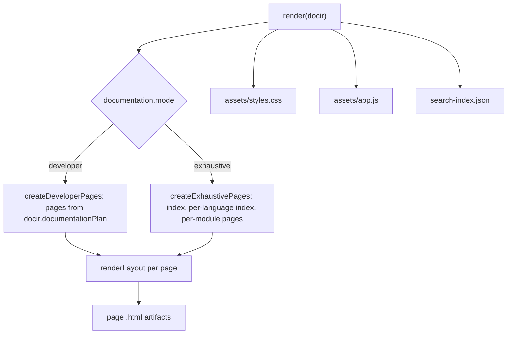

# @docgen/renderer-html -- Technical Reference

<!-- conduit-change: CONDUIT-2026-001 -->

> **Evidence.** Written from `packages/renderer-html/src/index.ts` and its test at RepoScribe commit `4cbc9e4` (2026-08-11). Statements marked *(by code reading)* are not covered by a test. The test suite was not re-run when this document was written.

## 1. Overview

`@docgen/renderer-html` is the static HTML site renderer. It takes a transformed DocIR and returns the files of a self-contained documentation site: one HTML page per documentation page, a stylesheet, a small client script and a search index. It has no runtime dependency other than `@docgen/core`, and generating the site needs no network access.

**Where it fits:** the render layer, next to `@docgen/renderer-markdown` and `@docgen/renderer-pdf`.

```
Source Code --> [Parsers] --> DocIR --> [Transformers] --> DocIR --> [@docgen/renderer-html] --> static site
                                                                     ^^^^^^^^^^^^^^^^^^^^^^
```

- **npm package:** `@docgen/renderer-html` v1.1.0
- **Dependency:** `@docgen/core` (workspace)
- **Source file:** `packages/renderer-html/src/index.ts` (410 lines, single file)
- **Export:** `HtmlRenderer` class (named and default export)
- **Plugin type:** `renderer`; `format = "html"`; `supports = ["html", "static-site"]`

---

## 2. Installation & Setup

The orchestrator loads `@docgen/renderer-html` automatically when `output.html.enabled` is `true`.

```yaml
project:
  name: My Project
  repository: https://github.com/example/my-project   # enables source links

output:
  html:
    enabled: true
    outputDir: docs-site
    baseUrl: /my-project/        # use "/" when served from a domain root
    search: true
    options:
      sourceBranch: main         # branch used in source links

documentation:
  mode: developer                # or "exhaustive"
```

### Settings the renderer reads

| Setting | Effect | Default |
|---|---|---|
| `output.html.baseUrl` | Prefix for every link and asset. Normalised to start and end with `/`. | `/` |
| `output.html.search` | Adds the search box and fetches `search-index.json` on demand | `true` |
| `output.html.options.sourceBranch` | Branch name in source links | `main` |
| `project.repository` | Base URL for source links; without it, source paths are plain text | none |
| `documentation.mode` | `developer` (planned guide pages) or `exhaustive` (one page per module) | `developer` |

`engine`, `theme` and `sidebar` are accepted by the config schema but **are not read** by this renderer *(by code reading)*; the site always uses its built-in layout and styles. `outputDir` is used by the caller that writes the artifacts; the renderer itself returns files in memory.

Programmatic use:

```typescript
import { HtmlRenderer } from "@docgen/renderer-html";

const renderer = new HtmlRenderer();
await renderer.initialize({ projectConfig: config, workDir: process.cwd(), options: {}, logger: console });
const artifacts = await renderer.render(docir, config.output);   // OutputArtifact[]
```

---

## 3. Architecture

### Single-file design

`HtmlRenderer` implements `RendererPlugin`. Page bodies, the layout, the client script and the stylesheet are built from string templates in the same file. There is no template engine and no bundler.

### Render flow



### Modes

- **developer** builds pages from `docir.documentationPlan`: README, architecture, project structure, setup, one page per feature, API, components, state, testing and troubleshooting. The plan page `README.md` (or `index.md`) becomes `index.html`; other `.md` paths become `.html`. The home page gets a "Documentation map" card grid, and the architecture page gets a Mermaid flowchart (sources, DocIR, Markdown, HTML, PDF) built from up to four tech-stack entries that match TypeScript, JavaScript, Java, React or Spring.
- **exhaustive** builds `index.html`, `<language>/index.html` and `<language>/<ModuleName>.html`. Module pages show badges, props for React components and a members list. Private members are omitted.

---

## 4. Public API Reference

```typescript
export class HtmlRenderer implements RendererPlugin {
  readonly name = "@docgen/renderer-html";
  readonly version = "1.1.0";
  readonly type = "renderer";
  readonly format = "html";
  readonly supports = ["html", "static-site"];

  async initialize(config: PluginConfig): Promise<void>;
  async validate(): Promise<PluginValidationResult>; // always valid
  async render(docir: DocIR): Promise<OutputArtifact[]>;
  async cleanup(): Promise<void>; // no-op
}
```

`render` takes only the DocIR; the second argument the orchestrator passes (the output config) is ignored. Each `OutputArtifact` has `filePath`, `content`, `mimeType`, `size` and `metadata` (`generatedAt`, `sourceModules`, `format: "html"`).

---

## 5. Output Structure

| Artifact | MIME type | Notes |
|---|---|---|
| One `.html` per page | `text/html` | Shared layout: skip link, top bar, sidebar navigation, optional search, content, footer |
| `assets/styles.css` | `text/css` | Embedded in the renderer; responsive; the sidebar collapses behind a Menu button below 800 px |
| `assets/app.js` | `text/javascript` | Search and menu toggle (a short inline script) |
| `search-index.json` | `application/json` | One entry per page: `title`, `path`, `summary` and `text` (tags stripped, first 4000 characters) |

**Search.** The browser fetches `search-index.json` on the first keystroke and filters entries by case-insensitive substring over title, summary and text. It shows up to 8 results. No search engine library is used.

**Source links.** Each page lists up to 8 of its source paths. With `project.repository` set, a path links to `<repository>/blob/<sourceBranch>/<path>`; a trailing `.git` is removed. Without it the path is shown as plain code text.

**Escaping.** All interpolated text and attribute values pass through `escapeHtml` / `escapeAttribute`. The only inline formatting supported in section text is backtick code spans.

---

## 6. Known Limitations

- **Diagrams need the network when a page is viewed.** Every page includes a module script that imports Mermaid from `https://cdn.jsdelivr.net/npm/mermaid@11/dist/mermaid.esm.min.mjs`. The major version is not pinned to an exact release and no integrity hash is set. Offline, or behind a firewall that blocks the CDN, diagrams show as plain text. Generation itself is offline.
- **Developer mode requires a plan.** Without `docir.documentationPlan` the renderer throws `Developer HTML output requires a documentation plan.` (Exhaustive mode does not need one.)
- **Exhaustive mode name collisions.** Page names are `<language>/<ModuleName>.html`. Two modules with the same name and language write the same file *(by code reading)*. Overloaded members on one page share an element id.
- **Exhaustive mode renders modules only.** It has no ADR or changelog pages.
- **No per-site theming.** `theme`, `sidebar` and `engine` are ignored (see section 2).
- **Search is basic.** Substring match only, no ranking, and only the first 4000 characters of each page are indexed.

---

## 7. Integration Guide

- **Producing a site:** set `output.html.enabled: true` and run `reposcribe-cli generate --format html` (`-f` is the short form; `--mode developer|exhaustive` overrides the mode). The `docs:generate` script requests Markdown and PDF only, so it does not build the HTML site. See [cli.md](cli.md).
- **GitHub Pages:** set `baseUrl` to `/<repository-name>/` so links and assets resolve under the project path, then publish `outputDir`. `docs/guides/ci-cd-integration.md` shows CI setups.
- **Java projects:** endpoint data from `@docgen/parser-java` is shown on member entries (method badge, path, response type) in exhaustive mode. See [parser-java.md](parser-java.md).
- **Other formats:** the same DocIR also feeds [renderer-markdown.md](renderer-markdown.md) and [renderer-pdf.md](renderer-pdf.md).

---

## 8. Internal Implementation Notes

- Module-level helpers: `collectPlanPages`, `toHtmlPath`, `normalizeBaseUrl`, `renderTable`, `formatInline`, `escapeHtml`, `escapeAttribute`, `stripTags`, `safeFileName`, `slug`, `displayLanguage`, `mermaidText`.
- `CLIENT_SCRIPT` and `STYLES` are string constants emitted verbatim as artifacts.
- The generator version in the footer comes from `docir.metadata.generatorVersion`.
- Mermaid is initialised with `securityLevel: 'strict'`.

### Tests

`packages/renderer-html/src/index.test.ts` has two tests:

1. A developer-mode site with `baseUrl: /demo/`: checks the expected artifacts exist (`index.html`, `architecture.html`, the asset files, `search-index.json`), that the architecture page contains a Mermaid block, the prefixed stylesheet URL and the GitHub source link.
2. An exhaustive-mode run: checks that `typescript/Widget.html` is produced.

```bash
pnpm build
pnpm --dir packages/renderer-html test
```

The end-to-end smoke test (`pnpm test:e2e`) also renders HTML for the `fixtures/e2e` project.
