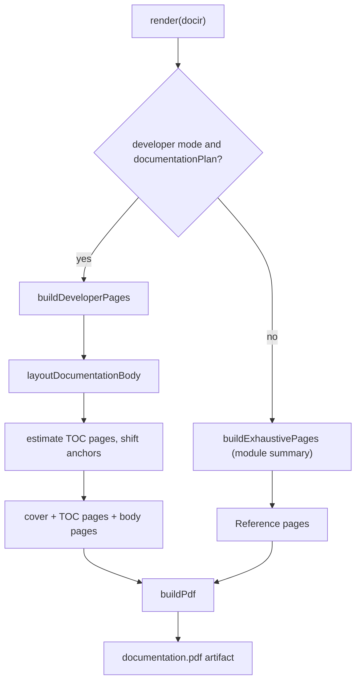

# @docgen/renderer-pdf -- Technical Reference

<!-- conduit-change: CONDUIT-2026-001 -->

> **Evidence.** Written from `packages/renderer-pdf/src/index.ts` and its test at RepoScribe commit `4cbc9e4` (2026-08-11). Statements marked *(by code reading)* are not covered by a test. The test suite was not re-run when this document was written.

## 1. Overview

`@docgen/renderer-pdf` produces a single combined PDF developer guide from a transformed DocIR. It writes the PDF file format itself (PDF 1.4) and has no PDF, browser or converter dependency, so it needs no network and no headless browser. The output is text-first: cover page, linked table of contents and the guide pages, with headings, paragraphs, bullet lists, code blocks and tables.

**Where it fits:** the render layer.

```
Source Code --> [Parsers] --> DocIR --> [Transformers] --> DocIR --> [@docgen/renderer-pdf] --> documentation.pdf
                                                                     ^^^^^^^^^^^^^^^^^^^^^
```

- **npm package:** `@docgen/renderer-pdf` v1.1.0
- **Dependency:** `@docgen/core` (workspace)
- **Source file:** `packages/renderer-pdf/src/index.ts` (948 lines, single file)
- **Export:** `PdfRenderer` class (named and default export)
- **Plugin type:** `renderer`; `format = "pdf"`; `supports = ["pdf"]`

---

## 2. Installation & Setup

The orchestrator loads `@docgen/renderer-pdf` automatically when `output.pdf.enabled` is `true`.

```yaml
output:
  pdf:
    enabled: true
    outputDir: docs/pdf
    options:
      fileName: my-project-developer-guide.pdf

documentation:
  mode: developer
```

### Settings the renderer reads

| Setting | Effect | Default |
|---|---|---|
| `output.pdf.options.fileName` | Name of the single output file (trimmed; must be a non-empty string) | `documentation.pdf` |
| `documentation.mode` | `developer` uses the documentation plan; `exhaustive` produces a module summary | `developer` |

`engine` (`puppeteer` or `pandoc`) and `branding` (logo, primary colour, company name) are accepted by the config schema but **are not read** by this renderer *(by code reading)*. Neither Puppeteer nor Pandoc is used or required, even though the schema default for `engine` is `puppeteer`. `outputDir` is used by the caller that writes the artifact.

Programmatic use:

```typescript
import { PdfRenderer } from "@docgen/renderer-pdf";

const renderer = new PdfRenderer();
await renderer.initialize({ projectConfig: config, workDir: process.cwd(), options: {}, logger: console });
const [artifact] = await renderer.render(docir, config.output);   // artifact.content is a Buffer
```

---

## 3. Architecture

### Two phases

1. **Layout.** Documentation pages are laid out onto page drafts (`PdfPageDraft`): a list of PDF drawing commands plus link annotations. Page size is A4 (595 x 842 points) with 54 pt side margins.
2. **Serialisation.** `buildPdf` writes the objects, page streams, link annotations, cross-reference table and trailer by hand.

### Fonts

Three standard PDF fonts are referenced by name and not embedded: Helvetica (body), Helvetica-Bold (headings) and Courier (code).

### Render flow



If the mode is `developer` but the DocIR has no documentation plan, the renderer silently produces the exhaustive summary layout. (The HTML renderer throws in the same situation.)

---

## 4. Public API Reference

```typescript
export class PdfRenderer implements RendererPlugin {
  readonly name = "@docgen/renderer-pdf";
  readonly version = "1.1.0";
  readonly type = "renderer";
  readonly format = "pdf";
  readonly supports = ["pdf"];

  async initialize(config: PluginConfig): Promise<void>;
  async validate(): Promise<PluginValidationResult>; // always valid
  async render(docir: DocIR): Promise<OutputArtifact[]>; // exactly one artifact
  async cleanup(): Promise<void>; // no-op
}
```

`render` takes only the DocIR; the second argument the orchestrator passes is ignored. The returned artifact has `mimeType: "application/pdf"`, a `Buffer` as `content`, and `metadata` with `generatedAt`, `sourceModules` and `format: "pdf"`.

---

## 5. Document Layout

### Developer mode

| Part | Content |
|---|---|
| Cover | Title (`<project> Developer Guide`), description, generation date, mode, page count, module count, guide count, Node version (or "project-specific"), up to four setup steps as a quick start |
| Table of contents | One entry per guide and per section, with page numbers and clickable links; spills onto more pages when long |
| Body | Plan pages in order: README, architecture, project structure, setup, each feature, API, components, state, testing, troubleshooting |

Every body page has a header (project and page title) and a footer with the page number and total. Within a page:

- A "Relevant Paths" card lists the page's source paths (first 6, then `+ N more paths`).
- **Paragraphs and bullets** are word-wrapped.
- **Code blocks** are drawn in Courier on a dark panel, in chunks of 18 lines. Lines are not wrapped or clipped.
- **Tables** use equal-width columns, wrap cell text, and alternate row shading.

### Exhaustive mode (module summary)

A "Reference" section lists, for each module: name and kind, path, coverage percentage and the first sentence of its description. It does not list members, endpoints or props.

---

## 6. Known Limitations

- **ASCII only.** Text is normalised before drawing: en and em dashes become `-`, curly quotes become straight quotes, the bullet becomes `*`, and **every other character outside printable ASCII is replaced with a space**. Accented letters, non-Latin scripts and emoji are lost.
- **No images, charts or diagrams.** Diagram source (for example Mermaid) placed in a code block is printed as code text, not drawn. See `docs/guides/pdf-images-and-charts.md`.
- **No inline formatting.** Backticks and other Markdown markers in plan text are printed as-is.
- **Approximate text metrics.** Wrapping assumes 0.53 x font size per character. A word longer than a line is split once at the line limit, so a very long unbroken string can still run past the margin.
- **Long code lines overflow** the panel's right edge instead of wrapping.
- **Minimal PDF features.** PDF 1.4, uncompressed, no bookmarks/outline, no document title metadata. Only the TOC link annotations are interactive.
- **Locale-dependent date.** The cover date uses `toLocaleDateString("en-IN")`.
- **In-memory build.** The whole file is assembled as one string before it is converted to a `Buffer`.
- **Shared anchor registry.** The TOC link targets are stored on `globalThis.__reposcribePdfAnchors` between layout and serialisation. Both steps run synchronously inside one `render` call, so renders do not interleave, but the registry keeps its last value afterwards.

---

## 7. Integration Guide

- **Producing a PDF:** set `output.pdf.enabled: true` and run `reposcribe-cli generate --format pdf`, or run the repository's `docs:generate` script, which requests Markdown and PDF. See [cli.md](cli.md).
- **Combining outputs:** the same DocIR feeds [renderer-markdown.md](renderer-markdown.md) and [renderer-html.md](renderer-html.md).
- **CI:** archive the PDF as a build artifact; see `docs/guides/ci-cd-integration.md`.
- **Java projects:** in exhaustive mode Java modules are listed in the module summary. Endpoint details from `@docgen/parser-java` are not rendered separately by this renderer.

---

## 8. Internal Implementation Notes

- Layout helpers: `layoutDocumentationBody`, `renderSection`, `renderParagraph`, `renderBulletList`, `renderCodeBlock`, `renderTable`, `renderRelevantPathsCard`, `buildCoverPage`, `buildTocPages`, `ensureSpace`.
- Drawing helpers: `drawText`, `drawRect`, `drawLine`, `drawWrappedText` (plus `drawTextCommands` / `drawLineCommands` for page chrome).
- Text helpers: `wrapText`, `normalizePdfText`, `estimateTextWidth`, `escapePdfText`.
- `estimateTocPageCount` reserves TOC pages before layout so that page numbers in the TOC are final.
- Anchor keys are `page:<filePath>` and `section:<filePath>#<heading-slug>`.

### Tests

`packages/renderer-pdf/src/index.test.ts` has one test. It renders a ten-page documentation plan and checks that the output starts with `%PDF`, has the `application/pdf` type, and contains the "Table of Contents" text, a `/Subtype /Link` annotation and several page titles.

```bash
pnpm build
pnpm --dir packages/renderer-pdf test
```

The test imports `../dist/index.js`, so the package must be built first.
